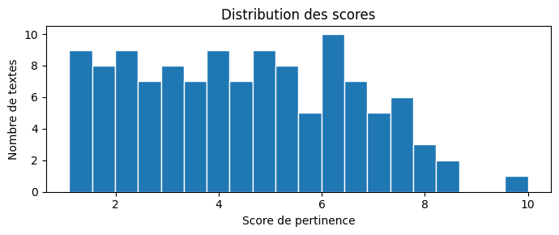
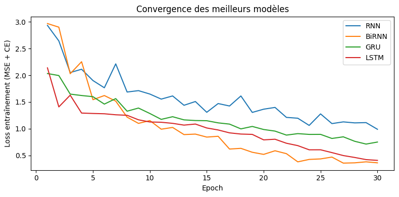
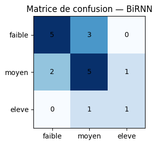

# Atelier 3 — NLP arabe & génération de texte

Devoir pratique en deux parties, exécuté sur **Google Colab (Tesla T4)** :

1. **Partie 1 — NLP arabe** : collecte (scraping), preprocessing, encodage, puis comparaison de
   quatre architectures récurrentes (**RNN, BiRNN, GRU, LSTM**) sur des embeddings **AraBERT** gelés,
   avec une tête de **régression** (score 0–10) et une tête de **classification** (3 classes).
2. **Partie 2 — Génération de texte** : fine-tuning d'un **GPT-2** (124 M) sur un dataset maison
   anglais et génération de paragraphes à partir d'une phrase imposée.

Tout le travail est dans le notebook exécuté : [`lab3.ipynb`](lab3.ipynb).

---

## Contenu du dépôt

```
lab3/
├── README.md
├── lab3.ipynb                     # notebook exécuté (sorties + figures, 19 cellules de code)
├── figures/                       # graphiques extraits du notebook
│   ├── 01_relevance_score_distribution.png
│   ├── 02_learning_curves.png
│   └── 03_confusion_matrix.png
└── data/
    ├── ar_ai_relevance.csv        # dataset arabe (Text, Score, Source, URL) — 120 lignes
    ├── custom_ai_paragraphs.csv   # dataset anglais de GPT-2 — 500 paragraphes
    ├── lab3_results.csv           # métriques finales des 4 architectures (partie 1)
    └── generated_paragraphs.txt   # textes générés par le GPT-2 fine-tuné (partie 2)
```

> Les artefacts lourds et reproductibles ne sont **pas** versionnés :
> `trained_models/*.pt` (checkpoints GPT-2, ~0.5 Go chacun), `data/arabert_emb.npy` (23 Mo) et
> `data/processed.npz`. Le notebook les régénère à l'exécution (voir `.gitignore`).

---

## Partie 1 — classification / régression sur du texte arabe

**Sujet** : `الذكاء الاصطناعي` (l'intelligence artificielle).

**Données.** Scraping avec `requests` + `BeautifulSoup` de 4 sources (Wikipédia arabe, BBC Arabic,
DW Arabic, France 24 Arabic) → **120 textes** (Wikipédia 35, BBC 35, DW 27, France 24 23).
Le score de pertinence (0–10) est **déterministe** : combinaison d'une similarité cosinus TF-IDF
(ngrammes de caractères 2–4) passée en rang percentile et du nombre de mots-clés trouvés.

**Pipeline NLP** (dans cet ordre) :

1. normalisation — suppression URLs/diacritiques/tatweel, unification `أ إ آ → ا`, `ى → ي`, `ة → ه` ;
2. tokenization par regex sur la plage arabe ;
3. suppression des *stop words* (liste arabe intégrée) ;
4. **stemming** avec `ISRIStemmer` (NLTK) ;
5. **lemmatization** approximative rule-based (retrait de clitiques/suffixes) ;
6. **discrétisation** : `faible [0,4[`, `moyen [4,7[`, `élevé [7,10]`.

Résultat : vocabulaire de **1 147** tokens, séquences de longueur 60, split stratifié
**84 / 18 / 18** (train/val/test), poids de classes `[1.0, 1.02, 3.06]`.

**Architectures.** Une classe commune : `Embeddings AraBERT (768, gelés) → Dropout → RNN/GRU/LSTM
→ Dropout → 2 têtes`. La perte est une somme pondérée `5·MSE(score/10) + CE(classe, poids inverses)`.
Chaque architecture teste **6 configurations** (`hidden_dim ∈ {64,128,256}`, `dropout ∈ {0.2,0.3,0.4}`,
`lr ∈ {1e-3, 5e-4}`) ; le meilleur modèle est choisi sur la **loss de validation**.

**Protocole d'évaluation** : MAE, RMSE, R² (régression) ; Accuracy, F1 macro, matrice de confusion
(classification) ; BLEU (protocole documenté, ici peu pertinent).

---

## Partie 2 — fine-tuning de GPT-2 et génération

**Dataset maison.** 500 paragraphes anglais générés par templates (`domain × tool × actor × action × …`),
entièrement reproductibles (seed 42). Chaque exemple est préfixé par `AI:` et terminé par
`<|endoftext|>`, puis concaténé en blocs de 400 tokens → **87 blocs (79 train / 8 val)**.

**Entraînement.** `AutoModelForCausalLM` (`gpt2`, 124 M paramètres), `AdamW` + warmup linéaire,
accumulation de gradients (×4, soit 100 pas d'optimiseur), gradient clipping, 5 epochs, sauvegarde
du meilleur modèle sur la pérdité de validation.

**Génération.** Rechargement du meilleur modèle puis échantillonnage `top-k` (k=40, température 0.9)
à partir de `AI: Artificial intelligence is transforming healthcare`, arrêt sur `<|endoftext|>`.

---

## Résultats

### Partie 1 — test (18 textes)

| Architecture | MAE | RMSE | R² | Accuracy | F1 macro | BLEU |
|---|---|---|---|---|---|---|
| **BiRNN** | 1.919 | 2.192 | −0.133 | **0.611** | **0.585** | 0.6111 |
| RNN | 1.962 | 2.139 | −0.079 | 0.444 | 0.433 | 0.4444 |
| GRU | 1.824 | 2.053 | 0.007 | 0.444 | 0.389 | 0.4444 |
| LSTM | **1.507** | **1.871** | **0.174** | 0.389 | 0.280 | 0.3889 |

- Meilleure **classification** : **BiRNN** (F1 macro 0.585).
- Meilleure **régression** : **LSTM** (MAE 1.507), seule architecture avec un R² positif.
- Tuning complet des 24 configurations : **~9 s** sur T4.

**Figures.**

Distribution des scores de pertinence (partie 1) :



Convergence des meilleurs modèles (loss d'entraînement) et matrice de confusion du meilleur
classifieur (BiRNN) :




### Partie 2 — GPT-2

| Epoch | train_loss | val_loss | val_ppl |
|---|---|---|---|
| 1 | 3.0343 | 1.7167 | 5.57 |
| 2 | 1.4119 | 0.9417 | 2.56 |
| 3 | 0.9127 | 0.7624 | 2.14 |
| 4 | 0.7851 | 0.7211 | 2.06 |
| 5 | 0.7565 | **0.7106** | **2.04** |

Entraînement : **109,1 s** sur T4. Génération (prompt imposé) : paragraphes cohérents, `distinct-2`
entre 0.830 et 0.905, arrêt sur `<|endoftext|>` pour 2 échantillons sur 3.
Exemples complets dans [`data/generated_paragraphs.txt`](data/generated_paragraphs.txt).

---

## Reproductibilité

- Environnement : **Google Colab**, runtime **GPU Tesla T4**, `torch 2.14.1+cu130`, `transformers` 5.x,
  `nltk`, `scikit-learn`, `beautifulsoup4` (tous préinstallés dans Colab).
- Graine fixée à **42** partout (`random`, `numpy`, `torch`).
- Pour relancer : ouvrir `lab3.ipynb` dans Colab et exécuter toutes les cellules. La cellule de
  scraping a des replis si un site renvoie moins de texte ; le dataset arabe peut donc varier
  légèrement d'un run à l'autre, ce qui décale marginalement les métriques de la partie 1.

---

## Ce que l'on retient

- **Sur ce type de tâche courte et bruitée, la cellule récurrente compte moins que les embeddings** :
  les 4 variantes partagent les mêmes features AraBERT gelées et restent proches (F1 macro 0.28–0.59).
- **La classification est plus robuste que la régression** : prédire une classe (faible/moyen/élevé)
  marche correctement (F1 0.585), tandis que prédire un score continu reste difficile
  (R² ≤ 0.17, plusieurs R² négatifs). Un score continu sur 120 exemples seulement est trop peu.
- **Le bidirectionnel aide pour classer, pas pour régresser** ici : le BiRNN gagne en classification
  mais dégrade la régression (R² négatif), tandis que le LSTM — meilleure mémoire longue — régresse mieux.
- **BLEU n'a pas de sens pour de la classification** : avec des étiquettes à un seul token, il se
  réduit à l'accuracy. Leçon : choisir une métrique adaptée à la tâche.
- **Le fine-tuning d'un petit LM est très efficace en faible ressource** : ~110 s suffisent pour faire
  chuter la perplexité de 5.57 à 2.04 et obtenir une génération dans le style du corpus. La limite
  est la **qualité du dataset** : un corpus synthétique par templates produit une génération
  répétitive ; un corpus réel plus large bénéficierait à la diversité.
- **Pipeline complet et reproductible** : scraping → preprocessing → encodage → modèles → évaluation
  → génération, le tout scripté et re-exécutable de bout en bout.
